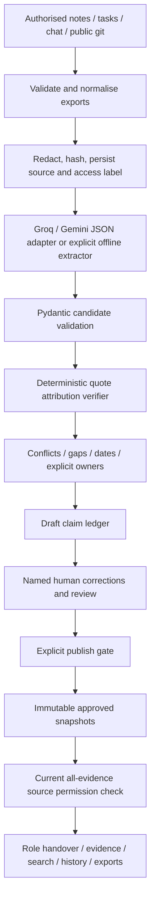

# Architecture and trust contract

## Storage and deployment

React uses same-origin JSON endpoints. Vite proxies to FastAPI in development; the production Python process serves built frontend assets. SQLite stores workspace JSON transactionally and separate password/session tables. A process-local lock serializes writes; deploy a **single worker/replica** with a persistent volume. This implementation is sized for a small hackathon project, not high-concurrency organisations. Snapshot content is deep-copied; source permission labels remain live.

## Evidence contract

Candidates contain text, category, owner, source ID, exact quote and optional subject/predicate/value. Code alone sets statuses:

- **Verified** means an extractive statement exactly matches a quote found in the cited redacted source. It proves attribution, not the truth of the source.
- **Inferred** covers failed quote matches and model paraphrases even when a quote exists. A human must attest or reject them.
- **Conflicting** means different explicit values share a subject/predicate. Neither wins automatically.
- **Gap** means context requires an answer.
- **Attested** means a named authenticated human supplied/corrected the statement, with a server timestamp. Original source receipts are retained; they need not literally contain the human correction.

Only verified and attested items can be approved. Publication requires every draft item to have a review decision; approved items become the handover, rejected items stay outside the snapshot. Human attestation and reviewer approval are separate actions.

## Access and privacy

Reviewer: core + technical + leads. Successor/leaver: core + technical. Coordinator: core. Every claim requires every evidence source to exist and be accessible. Restricted stubs disclose only existence, an opaque ID and the reviewer contact; titles, quotes, categories, conflict edges and dates are removed. All relevant read endpoints reapply access checks, including historical snapshots, search, export and evidence inspection. Non-reviewers do not receive the activity log. Successor/coordinator see only published snapshots. Leaver sees accessible draft gaps to answer them.

Sessions are cryptographically random, hashed in SQLite, time-limited (8 hours) and sent as HttpOnly SameSite Strict cookies. Passwords use PBKDF2-HMAC-SHA256 (200,000 rounds); login is rate limited per direct client IP. Mutation requests require a custom same-origin header and no CORS is enabled. Hosted use requires secure cookies and TLS. Account credentials are provided through environment variables, not checked into source. Fixed role accounts and no MFA/password-reset/invite flow remain explicit limitations.

Regex masking runs before source persistence/model calls and on named human corrections. Unredacted source content is not retained. Redaction is heuristic; use synthetic data for judging. GitHub import accepts only strict public github.com repository URLs and sends requests only to fixed api.github.com endpoints with redirects disabled. Imports are capped at 250k characters each and 40 sources. No live monitoring is implemented.

Permission/source changes invalidate current acknowledgement records. They cannot revoke previously downloaded files, screenshots or already-rendered browser content. A reader must make a new request/reload. Removed evidence makes historical dependent claims inaccessible and draft claims require review. Audit events are appended by application code but are not cryptographically sealed.

## AI and outages

The backend supports Groq strict JSON-schema output and Gemini JSON extraction through direct HTTPX adapters. `auto` prefers Groq when configured, then Gemini; explicit provider selection overrides that order. Backend `.env` loads at startup without overriding host environment variables. Keys never enter the frontend, extraction cache or activity log. Groq-format keys are included in the source redaction patterns.

Only redacted source IDs/content are transmitted. A second cloud provider is used only when explicitly enabled with `LLM_FALLBACK_PROVIDER`; the default is offline fallback. Requests have a configurable 15-second default I/O timeout and 5-second connect timeout, with at most two attempts per provider. Connection failures, 429s and server errors may retry once; Retry-After values over two seconds cause immediate fallback rather than a long wait. Authentication/request/model errors are not retried. Status messages classify failures without exposing upstream response bodies or exception details.

Truncated, empty, malformed or schema-invalid output is never treated as successful extraction. Model responses pass Pydantic validation before the existing quote verifier. Strict-schema adaptation closes objects and requires every field while application-level length/count limits remain in Pydantic. Successful extraction is cached against source identity/content, provider/model settings and credential presence, never secret values. Fallback results are not cached so a later reconstruction can retry the provider.

The offline path quotes source lines directly and uses narrow category heuristics, retaining uncertainty instead of fabricating missing facts. Model calls remain synchronous; a durable background queue is deferred. Source instructions are treated as data in the extraction prompt. Quote verification and human approval remain independent controls even if prompt injection affects extraction. `scripts/check_llm.py` bypasses the reconstruction cache and sends only a small synthetic example for live connection checking.
