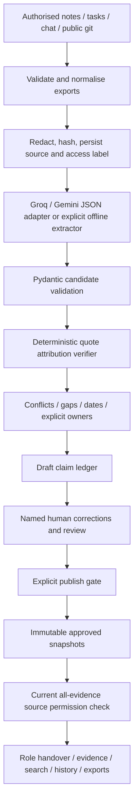

# Architecture and trust contract

## Storage and deployment

React uses same-origin JSON endpoints. Vite proxies locally; Vercel serves the built frontend and routes `/api` to FastAPI. Supabase stores normalized sources, draft/versioned claims, snapshot metadata, content-free claim indexes, audit events, acknowledgements, actions and question assignments. Credentials, sessions, invitation hashes and extraction cache stay in a private schema. Every application table has enabled/forced RLS. The backend connects as a non-bypass runtime account, not `postgres` or `service_role`.

After validating the application session, each transaction sets trusted role, user ID and display-name context. RLS filters records before Python's response filter. A transaction advisory lock serializes the small workspace across instances. Claim visibility requires every evidence source to be currently accessible; a separate content-free index enables neutral stubs. Published rows are immutable, audit runtime grants are append-only, and anonymous/Data API roles have no application-table grants. These are backend-context RLS policies, not Supabase Auth JWT policies.

Named members join through 24-hour single-use invitations and choose salted PBKDF2 passwords. Revocation invalidates sessions. Database policies additionally restrict per-user receipts and owned action updates. The application remains one workspace, not organisation-wide multi-tenancy. Without `DATABASE_URL`, the portable SQLite/test path retains application access checks and requires one worker.

## Evidence contract

Candidates contain text, category, owner, source ID, exact quote and optional subject/predicate/value. Code alone sets statuses:

- **Verified** means an extractive statement exactly matches a quote found in the cited redacted source. It proves attribution, not the truth of the source.
- **Inferred** covers failed quote matches and model paraphrases even when a quote exists. A human must attest or reject them.
- **Conflicting** means different explicit values share a subject/predicate. Neither wins automatically.
- **Gap** means context requires an answer.
- **Attested** means a named authenticated human supplied/corrected the statement, with a server timestamp. Original source receipts are retained; they need not literally contain the human correction.

Only verified and attested items can be approved. Publication requires every draft item to have a review decision; approved items become the handover, rejected items stay outside the snapshot. Human attestation and reviewer approval are separate actions.

## Access and privacy

Reviewer: core + technical + leads. Successor/leaver: core + technical. Coordinator: core. Every claim requires every evidence source to exist and be accessible. Restricted stubs disclose only existence, an opaque ID and the reviewer contact; titles, quotes, categories, conflict edges and dates are removed. All relevant read endpoints reapply access checks, including historical snapshots, search, export and evidence inspection. Non-reviewers do not receive the activity log. Successor/coordinator see only published snapshots. Leaver sees accessible draft gaps to answer them.

Sessions are random, hashed in the selected database, valid for eight hours and sent in HttpOnly SameSite Strict cookies (Secure in production). Passwords use PBKDF2-HMAC-SHA256 with 200,000 rounds; named accounts have random salts. Roles come from current account records, not client-selected roles or user-editable JWT metadata. Revocation is checked on every request. Login failure throttling is currently per process/client IP, so distributed throttling remains future hardening. Mutation requests require a custom header; no CORS is enabled. Production rejects old demo logins unless a unique password is explicitly configured for that role. Supabase Auth, MFA, SSO and password recovery are not implemented.

Regex masking runs before source persistence/model calls and on named human corrections. Unredacted source content is not retained. Redaction is heuristic; use synthetic data for judging. GitHub import accepts only strict public github.com repository URLs and sends requests only to fixed api.github.com endpoints with redirects disabled. Imports are capped at 250k characters each and 40 sources. No live monitoring is implemented.

Source-permission and continuation-action changes invalidate acknowledgements and display a re-review notice. Receipts are tied to the named user's ID and version. Actions link to approved claims and inherit their evidence access; only the reviewer or assigned owner can update them, and reassignment is reviewer-only. Exports include accessible actions with receipts. Version diffs cover text/owner/status/type/attestation, and historical evidence requests use an explicit version. Downloaded files, screenshots and already-rendered content cannot be recalled; a new request is required. Audit history is not cryptographically sealed against database administrators.

## AI and outages

The backend supports Groq strict JSON-schema output and Gemini JSON extraction through direct HTTPX adapters. `auto` prefers Groq when configured, then Gemini; explicit provider selection overrides that order. Backend `.env` loads at startup without overriding host environment variables. Keys never enter the frontend, extraction cache or activity log. Groq-format keys are included in the source redaction patterns.

Only redacted source IDs/content are transmitted. A second cloud provider is used only when explicitly enabled with `LLM_FALLBACK_PROVIDER`; the default is offline fallback. Requests have a configurable 15-second default I/O timeout and 5-second connect timeout, with at most two attempts per provider. Connection failures, 429s and server errors may retry once; Retry-After values over two seconds cause immediate fallback rather than a long wait. Authentication/request/model errors are not retried. Status messages classify failures without exposing upstream response bodies or exception details.

Truncated, empty, malformed or schema-invalid output is never treated as successful extraction. Model responses pass Pydantic validation before the existing quote verifier. Strict-schema adaptation closes objects and requires every field while application-level length/count limits remain in Pydantic. Successful extraction is cached against source identity/content, provider/model settings and credential presence, never secret values. Fallback results are not cached so a later reconstruction can retry the provider.

GPT-OSS uses low reasoning effort for this bounded extraction task; its medium default exhausted the output budget on a complete synthetic project during live testing. The cache pipeline version was incremented after this change. A complete response still passes the same schema, attribution and human-review gates; reducing reasoning effort does not grant claims verified status.

The offline path quotes source lines directly and uses narrow category heuristics, retaining uncertainty instead of fabricating missing facts. Model calls remain synchronous; a durable background queue is deferred. Source instructions are treated as data in the extraction prompt. Quote verification and human approval remain independent controls even if prompt injection affects extraction. `scripts/check_llm.py` bypasses the reconstruction cache and sends only a small synthetic example for live connection checking.
